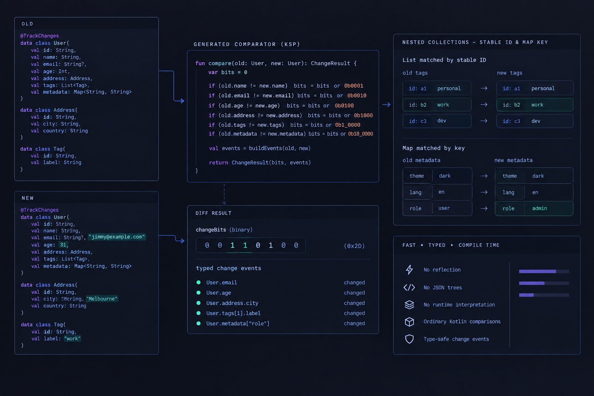

# Differ

<p align="center">
  
</p>


Compile-time, ID-keyed diffs for Kotlin data classes.

Site: [ultish.github.io/differ](https://ultish.github.io/differ/)

Annotate the fields you care about. KSP generates a `*Differ` that compares two values of the same type. Detection is a bit test. Values are sealed events for what actually changed. Children are matched by id, never by position.

Convert Avro and Mongo at the boundary. The walk is same-type only, `Pet` versus `Pet`.

## Install

Requires Kotlin 2.1 or later. Apply a KSP plugin that matches **your**
Kotlin. The processor is built against the KSP 2.1 API. A newer KSP
host can run it.

```kotlin
plugins {
    kotlin("jvm") version "2.1.21" // or newer
    id("com.google.devtools.ksp") version "2.1.21-2.0.2" // match your Kotlin
}

dependencies {
    implementation("io.github.ultish:differ-annotations:0.1.11")
    ksp("io.github.ultish:differ-processor:0.1.11")
}
```

Maven Central. No extra repository. Imports are `hana.differ`.

| Your Kotlin | KSP plugin |
|---|---|
| 2.1.21 | `2.1.21-2.0.2` |
| 2.2.x | `2.2.x-2.0.x` |
| 2.3 / 2.4 | `2.3.x` |

## Usage

```kotlin
import hana.differ.Differ
import hana.differ.Tracked
import hana.differ.TrackedList
import hana.differ.TrackedMap
import hana.differ.TrackedNested

@Differ
data class Pet(
    val id: String,
    @Tracked val name: String,
    @Tracked(captureValues = false) val notes: String,
    @Tracked val nickname: String?,
    @TrackedNested val owner: Person,
    @TrackedNested val vet: Person?,
    @TrackedList val toys: Set<Toy>,
    @TrackedList val walks: List<Walk>,
    @TrackedMap val tricks: Map<String, Trick>,
    @TrackedMap val tags: Map<String, String>,
)
```

`Person`, `Toy`, `Walk`, and `Trick` do not take `@Differ`. Their tagged fields fold into `PetDiffer`.

```kotlin
val diff = PetDiffer.diff(stored, incoming)

if (!diff.hasChanged) return

if (diff.hasName) { /* bit test */ }

for (change in diff.changes) {
    when (change) {
        is PetChange.ToysName -> {
            change.id
            change.old
            change.new
        }
        is PetChange.Vet -> change.new
        else -> {}
    }
}

diff.toys["t1"]?.name?.new
diff.tags["color"]?.value?.new
```

`hasChanged` and `hasToysName` are bit tests. `changes` and the keyed maps contain only children that changed. You do not walk the original collection again.

`@Tracked(captureValues = false)` still sets the bit and still emits a flag event. It does not copy old/new.

A rename of a tagged property fails the build. A new untagged field is invisible.

## Collections

`@TrackedList` is any `List` or `Set`, including `SortedSet` and `TreeSet`. A set is copied for the walk. Matching is by `matchBy` (default `id`), never by order.

`@TrackedMap` is any `Map`, including `SortedMap` and `TreeMap`. The map key is the id. Object values walk `@Tracked` fields. Scalar values (`String`, numbers, enums) compare with `!=`.

Nullable `List` / `Set` / `Map` treat `null` as empty.

`@Tracked` nullable scalars compare with `!=`. `@TrackedNested` on `T?` records presence. Both null is unchanged. One null is a single event with the whole object. Both present walks the child fields.

### Null old value

`diff(old: T?, new: T)` accepts a `null` old value, such as a first save with nothing stored. Every tracked field counts as changed.

- `hasChanged` is `true` and every `has*` bit is set except the `Removed` bits of lists, sets and maps. Nothing was removed, so those bits stay clear and no `*Removed` event is emitted.
- Each `@Tracked` scalar emits a `<Name>Initial` event with only `new`. With `captureValues = false` it emits the usual flag event.
- A `@TrackedNested` on `T?` that is present emits the presence event with `old = null`, then its child fields emit `Initial` events. A nested object that is `null` in `new` emits no event.
- Every `@TrackedList` / `@TrackedMap` entry in `new` emits an `Added` event. The keyed maps on the diff stay empty.

- `@Tracked(skipWhenNew = true)` opts a property out. With a `null` old value it sets no `has*` bit and emits no change event, so a default such as a `false` flag does not read as a change on a first save. It works on root properties, on `@TrackedList` / `@TrackedMap` element properties and on `@TrackedNested` properties. `hasChanged` is still `true` when other tracked properties are set.

With a non-null old value nothing changes, including for `skipWhenNew` properties, which compare as usual.

Primitive arrays (`IntArray` and the rest) are not keyed collections. Mark them `@Tracked` and compare the whole array.

## Modules

`differ-annotations` is the runtime (`@Differ`, `@Tracked`, `ValueChange`). `differ-processor` is KSP only. `differ-tests` is this repo's proof, not an artifact.

## Benchmark

A fat `Plant` (nested site and address, optional failover, two reversed link lists, alarm set, recipe map, label map). On Java 17, 256 keyed children, unchanged: handwritten 13 µs, this library 21 µs, JSON Patch (Jackson + zjsonpatch, id-keyed) 0.82 ms, JaVers 3.7 ms. The hand walk is faster. Differ is the one you do not maintain.

```sh
./gradlew :differ-benchmark:jmh
```

`-Pjmh.includes=PlantBenchmark` or `IndexBenchmark` to limit.

## Publishing

Pushing a `v*` tag publishes both artifacts to Maven Central through `.github/workflows/publish.yml`. After the upload succeeds, the workflow also creates a GitHub Release for the tag with generated notes.

1. Set `differVersion` in `gradle.properties`, and the version in the README and `docs/index.html`.
2. Commit and push `main`.
3. `git tag v<version> && git push origin v<version>`.

The workflow runs `./gradlew publishAndReleaseToMavenCentral`. It needs the repository secrets `MAVEN_CENTRAL_USERNAME`, `MAVEN_CENTRAL_PASSWORD`, `SIGNING_KEY` and `SIGNING_PASSWORD`. A released version cannot be replaced, so bump the version rather than re-tagging. The workflow can also be run by hand from the Actions tab.

## Limits

The mask is a `Long`, then a `LongArray` past 64 slots. Add/remove, nullable nested presence, and every nested leaf each take one slot. Same-type comparison only.
